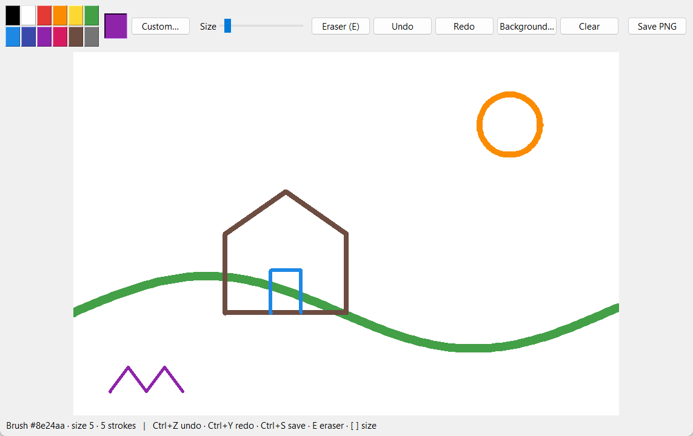

# Sketchpad

A desktop drawing app built with Python, Tkinter and Pillow. It has smooth round brush
strokes, undo/redo, an eraser, a colour palette with a custom picker, adjustable brush size,
background colour, and true PNG/JPEG export.



## Features

- **Smooth strokes**: round caps and joins, so fast mouse movements don't leave gaps.
- **Undo / redo** for every stroke, including eraser strokes.
- **12-colour palette** plus a custom colour picker, and a changeable background.
- **Real image export**: saves a pixel-exact PNG or JPEG of the canvas, on Windows, macOS or Linux.
- **Keyboard shortcuts**: `Ctrl+Z` undo, `Ctrl+Y` redo, `Ctrl+S` save, `E` eraser, `[` / `]` brush size.
- **Status bar** showing the current tool, size and stroke count.

## How it works

Every stroke is drawn twice: once on the Tk canvas (what you see) and once on an
off-screen Pillow image (what gets saved). Strokes are also kept as a list of points,
which makes undo/redo simple and exact. Undo pops a stroke and replays the rest onto a
fresh canvas and image.

Saving writes the Pillow image directly, rather than screenshotting the window. That
means it works on every OS and is never affected by other windows on top or by display scaling.

## Run

```bash
pip install -r requirements.txt
python drawing.py
python -m pytest        # tests (need a display; skipped on headless machines)
```
